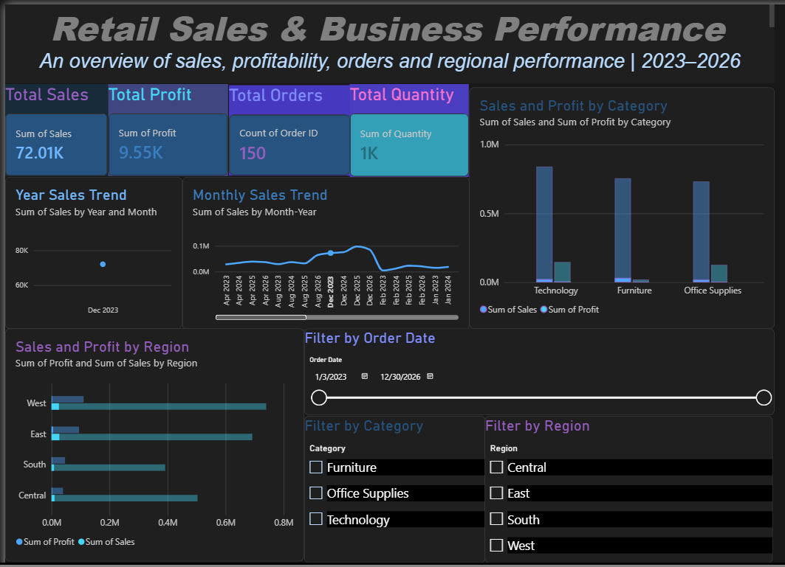

# Retail Sales & Business Performance Analysis

## Project Overview

This project analyzes retail sales data to understand business performance, identify sales and profitability trends, and generate actionable business insights.

## Objectives

- Analyze sales and profit performance.
- Identify the best-performing categories and regions.
- Investigate loss-making product sub-categories.
- Understand customer segments and purchasing trends.
- Build an interactive Power BI dashboard.
- Provide data-driven business recommendations.

## Tools & Technologies

- Python
- Pandas
- Matplotlib
- MySQL
- Power BI
- Git & GitHub

## Dataset

**Dataset:** Sample Superstore

The project uses retail transaction data containing information about orders, products, customers, sales, profit, quantity, discounts, and regions.

## Project Status

Project completed and published on GitHub.

## Project Structure

Retail-Sales-Analysis/
│
├── dashboard/
│   └── Retail_Sales_Dashboard.pbix
│
├── data/
│   ├── processed/
│   │   └── superstore_cleaned.csv
│   └── raw/
│       └── sample_-_superstore.xls
│
├── images/
│   └── dashboard_screenshot.png
│
├── notebooks/
│   ├── phase1_notes.md
│   └── retail_sales_analysis.ipynb
│
├── reports/
│   ├── dashboard_documentation.md
│   └── Retail_Sales_Business_Findings_Report.pdf
│
├── sql/
│   ├── 00_database_setup.sql
│   ├── 01_import_configuration.sql
│   ├── 02_data_import_validation.sql
│   └── 03_basic_sql_queries.sql
│
├── requirements.txt
├── .gitignore
└── README.md

## Installation & Setup

Follow these steps to set up and run the project on your local machine.

### 1. Prerequisites

Install the following:

- Python 3.13.2 (or a compatible Python version)
- Git
- MySQL Server and MySQL Workbench (for SQL analysis)
- Power BI Desktop (for the dashboard)

### 2. Clone the Repository

Open your terminal or Command Prompt and run:

```bash
git clone https://github.com/anushkaa018/Retail-Sales-Analysis.git
```

Navigate into the project directory:

```bash
cd Retail-Sales-Analysis
```

Alternatively, download the repository as a ZIP file and extract it.

### 3. Create a Virtual Environment

```bash
python -m venv .venv
```

Activate it on Windows:

```bash
.venv\Scripts\activate
```

### 4. Install Required Python Packages

Install all required dependencies with one command:

```bash
pip install -r requirements.txt
```

The requirements file includes:

- **Pandas:** Data manipulation and analysis.
- **Matplotlib:** Data visualisation.
- **xlrd:** Reading the original Excel `.xls` dataset.
- **Notebook:** Running Jupyter Notebook.

### 5. Run the Jupyter Notebook

Launch Jupyter Notebook:

```bash
jupyter notebook
```

Open the analysis notebook from the `notebooks/` folder:

```text
retail_sales_analysis.ipynb
```

Run the notebook cells in order to explore the dataset and reproduce the analysis.

### 6. Run the SQL Analysis (Optional)

1. Install and open MySQL Server and MySQL Workbench.
2. Connect to your local MySQL server.
3. Open the SQL scripts from the `sql/` folder.
4. Follow the database setup and data-loading instructions in the scripts.
5. Execute the analysis queries.

### 7. Open the Power BI Dashboard (Optional)

1. Install Power BI Desktop.
2. Open the `.pbix` file from the `dashboard/` folder.
3. If the data source path is unavailable, update it to the dataset location on your machine.
4. Refresh the report to load the data.

**Note:** MySQL and Power BI are separate applications. They are not installed through Python's `requirements.txt` file.

## Key Business Findings

1. **Category Performance:** Technology generated the highest sales and profit among the product categories.
2. **Regional Performance:** The West region recorded the highest sales and profit.
3. **Furniture Profitability:** Tables had the lowest average profit (-54.46), while Chairs had the highest average profit (42.94).
4. **Customer Segment:** Consumer was the highest-performing segment by sales.
5. **Monthly Sales:** Sales were generally stronger from September to December.
6. **Top Product:** Canon imageCLASS 2200 Advanced Copier ranked highest among the top 10 products by sales.

## Dashboard

An interactive Power BI dashboard was created to explore sales, profit, orders, quantity, category performance, regional performance, and sales trends.

## Dashboard Preview



## Business Recommendations

- Review pricing, costs, and discount levels for Furniture Tables.
- Investigate the practices contributing to the West region's strong performance.
- Plan inventory and marketing around the observed monthly sales patterns.

## Limitations

- The analysis is based on historical data and does not predict future performance.
- The analysis identifies relationships but does not establish causation.
- Seasonal patterns require further investigation using additional years of data.
- The dataset does not provide a complete view of operating expenses or all cost drivers.
- Power BI KPI values are displayed with rounding.